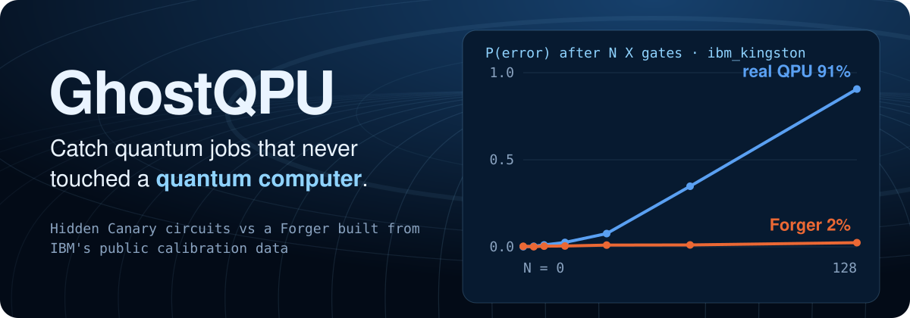
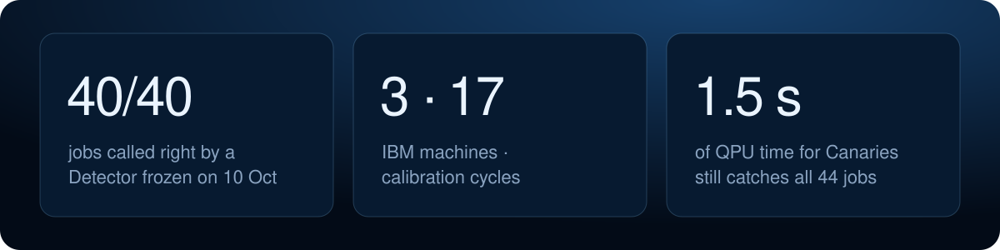
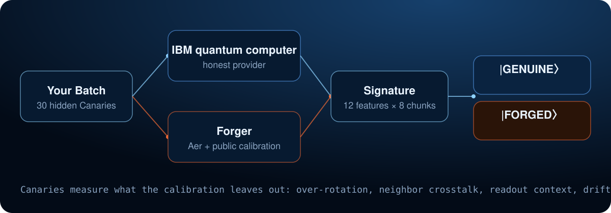

<p align="center">
  
</p>

<p align="center">
  <b>Q-Hack India 2026</b> · Team <b>lwyrup</b> · Quantum Security &amp; Cryptography
  <br>
  Neelagiri Karthikeya (lead) · L Mohit Jain · Tanvi Jain · Aditi Gorti
  <br>
  <a href="https://jacklachan.github.io/GhostQPU/"><b>Live site</b></a> · <a href="docs/GhostQPU_QHack_India26.pptx"><b>Slides (PPT)</b></a> · <a href="#run-it">Run it locally</a> · <a href="docs/PRESENTATION.md">Presenter notes</a> · <a href="https://drive.google.com/drive/folders/1M0DklU9nP6OGHuq1RZSj4r4Gzi0MHY0b">Demo video</a> · <a href="#results">Results</a> · <a href="docs/research/">Research notes</a>
</p>

You pay a cloud reseller for time on a quantum computer. How do you know your job ever ran on one? IBM publishes calibration data for every machine, and anyone can turn it into a simulator that returns believable results. **GhostQPU hides small Canary circuits in your Batch** that probe physics the published calibration leaves out, and a small Detector turns their results into a Verdict: **Genuine** or **Forged**.

We built both sides: the **Forger** (the attack, simulating each job from the exact calibration that was live when it ran) and the **Detector**. Vocabulary is in [CONTEXT.md](CONTEXT.md).

## Proof

<p align="center">
  
</p>

- **Frozen and blind.** Trained once on two jobs from 10 October, never retrained, then scored every later job: **46 of 46 correct** (23 real jobs and their forged copies) over 18 calibration cycles and 4 days, including **ibm_fez and ibm_kingston, which it had never seen**.
- **Forward in time.** Trained only on earlier days and scored on the next: **46 of 46**, AUC 1.00.
- **Cheap.** **1.5 QPU seconds** of Canary time (19 circuits x 250 shots) still calls all 50 jobs correctly, 85% less than our current Batches use, and no single Canary family manages it alone. **Checked on hardware over two days:** 12 of 12 real 250-shot runs (6 jobs and their forged copies) called right; IBM bills about 2 s of fixed overhead per job on top, so each billed 4 to 5 s.
- **Why the scores are perfect:** public calibration has no coherent-error term, so a calibration-only Forger is 2 to 4% wrong after 128 X gates where real hardware is 30 to 90%. Against our stronger Forger, which learns hardware effects from a real job, the original Detector fails ([Limits](#limits)).
- **It detects physics, not formatting.** With a simulator on both sides, the same pipeline scores AUC **0.52**, chance level, as it must.
- **Real hardware, real data.** Every Run, Twin and calibration snapshot is committed in [data/](data/).

<p align="center"></p>

## How it works

<p align="center">
  
</p>

1. **Hide the Canaries.** Each Batch is 34 circuits: 4 of yours and 30 Canaries with a known ideal answer, compiled to native gates on physical qubits and shuffled, so the provider cannot tell them apart.
2. **Run.** An honest provider runs it on IBM hardware. A Forger runs the same circuits through Qiskit Aer with the noise model built from the calibration that was live at execution time.
3. **Measure what calibration leaves out.** Coherent over-rotation (P(1) after up to 128 X gates), neighbor crosstalk (an idle qubit shifting when its neighbor flips), readout that depends on the neighbor, and drift during the job. Twelve features per eighth of the job.
4. **Decide.** A logistic-regression Detector returns a forged score. Below 0.35 is Genuine, above 0.65 is Forged, in between is Inconclusive.

<p align="center"></p>

## Run it

**The interactive site** is live at **https://jacklachan.github.io/GhostQPU/** (deployed by `.github/workflows/pages.yml` on every push). It tells the story in six chapters, with a console that replays any real job, a Bloch sphere driven by measured data, and a lab where you play the Forger against the real frozen Detector. No IBM account needed:

```sh
cd web
npm install
npm run dev        # http://localhost:3000
```

Chapters are linkable: `#problem`, `#trap`, `#run`, `#evidence`, `#verdict`, `#break`. For an offline copy, `npm run build` writes static files to `web/out/`; serve them with `python -m http.server 8080 -d web/out`.

**The backend API** (FastAPI) serves the frozen Detector and every committed Run over HTTP, with interactive docs at `/docs`:

```sh
.venv/Scripts/python -m uvicorn ghostqpu.api:app --port 8000
# GET /runs                      every committed Run
# GET /runs/{run_id}/verdict     the frozen Detector's Verdict, with per-chunk scores
# GET /detector                  features, weights and fingerprint
```

**The Python pipeline:**

```sh
python -m venv .venv
.venv/Scripts/python -m pip install -r requirements.txt   # macOS / Linux: .venv/bin/python
.venv/Scripts/python -m ghostqpu null-test                # simulator vs Forger, must score near chance
.venv/Scripts/python -m ghostqpu evaluate                 # held-out Detector report on data/runs
```

**Check one job** with the frozen Detector:

```sh
.venv/Scripts/python -m ghostqpu verify data/fresh/ibm_kingston_20261029T154358_88635
# ibm_kingston_20261029T154358_88635: Genuine (forged score 0.000; below 0.35 Genuine, above 0.65 Forged)
```

<details>
<summary><b>Collect your own hardware runs</b> (spends IBM QPU time, about 11 s per job)</summary>

The commands below use `python` for the venv's interpreter.

1. Save each IBM account (the API key is read hidden; get it from quantum.cloud.ibm.com):

   ```sh
   python -m ghostqpu add-account alice
   python -m ghostqpu accounts          # backends + remaining QPU time per account
   ```

2. Submit a Batch (34 circuits: 30 hidden Canaries + 4 workload circuits, 1000 shots by default):

   ```sh
   python -m ghostqpu submit --account alice --backend ibm_kingston
   ```

3. When the job finishes, collect it. This saves the Genuine Run, fetches the calibration that was valid when the job **started**, and forges its Twin right away. Use `--into data/fresh` to score it blind with the frozen Detector:

   ```sh
   python -m ghostqpu collect --into data/fresh
   PYTHONPATH=. python scripts/score_fresh.py
   ```

4. Refresh the site's data:

   ```sh
   PYTHONPATH=. python scripts/export_web_data.py
   PYTHONPATH=. python scripts/cost_and_forward.py
   ```

</details>

<p align="center"></p>

## Results

### First jobs (10 October)

Two real jobs on IBM **ibm_marrakesh** (34 circuits x 1000 shots, 11 QPU seconds each), each with a forged Twin from the calibration that was live when it ran.

| Canary | Real hardware | Forger |
|---|---|---|
| Error after 128 X gates | 32% | 4% |
| Idle-qubit shift from neighbor (16 us) | 7.8% | 0.4% |
| Readout error | 1.1 to 1.4% | 0.3 to 0.5% |

Detector, each job held out from training: **AUC 1.00**, all 4 jobs correct (Genuine scores 0.02 and 0.06, Forged 0.96 and 0.98). Both jobs share one calibration cycle. This Detector was then frozen.

### Frozen Detector, scored blind on every later job

Trained on the two 10 October jobs above, then frozen. Nothing was retrained or tuned before scoring these.

| Machine | Seen in training? | Real jobs | Calibration cycles | Real jobs called Genuine | Forgeries caught | What gave it away |
|---|:---:|:---:|:---:|:---:|:---:|---|
| **ibm_marrakesh** | 10 Oct only | 8 | 6 | **8 / 8** | **8 / 8** | a mix: over-rotation, crosstalk, readout |
| **ibm_fez** | never | 8 | 6 | **8 / 8** | **8 / 8** | neighbor crosstalk, then over-rotation |
| **ibm_kingston** | never | 7 | 6 | **7 / 7** | **7 / 7** | coherent over-rotation (91% vs 2% after 128 X gates) |
| **Total** | | **23** | **18** | **23 / 23** | **23 / 23** | 0 errors; 95% bound 0.12 per job, 0.15 per cycle |

<details>
<summary><b>Every job</b> (forged score: below 0.35 Genuine, above 0.65 Forged)</summary>

| Job | Machine | Calibration cycle | Qubits | Real job | Its forged Twin |
|---|---|---|---|:---:|:---:|
| J1 | marrakesh | 27 Oct 12:06 | new | 0.18 ✅ | 0.99 ✅ |
| F1 | fez | 29 Oct 19:59 | new | 0.02 ✅ | 0.99 ✅ |
| J2 | marrakesh | 29 Oct 20:01 | new | 0.00 ✅ | 0.99 ✅ |
| K1 | kingston | 29 Oct 20:38 | new | 0.00 ✅ | 0.99 ✅ |
| K2 | kingston | 29 Oct 21:18 | same as K1 | 0.00 ✅ | 0.99 ✅ |
| F2 | fez | 29 Oct 21:22 | same as F1 | 0.00 ✅ | 0.99 ✅ |
| K3 | kingston | 30 Oct 21:01 | new | 0.00 ✅ | 1.00 ✅ |
| K4 | kingston | 30 Oct 21:01 | same cycle as K3 | 0.02 ✅ | 0.99 ✅ |
| J3 | marrakesh | 30 Oct 21:03 | new | 0.36 ⚠️ | 0.99 ✅ |
| J4 | marrakesh | 30 Oct 21:03 | same cycle as J3 | 0.43 ⚠️ | 0.99 ✅ |
| F3 | fez | 30 Oct 21:05 | new | 0.00 ✅ | 0.99 ✅ |
| F4 | fez | 30 Oct 21:05 | same cycle as F3 | 0.00 ✅ | 0.99 ✅ |
| J5 | marrakesh | 30 Oct 22:05 | J3's, recalibrated | 0.00 ✅ | 0.99 ✅ |
| K5 | kingston | 30 Oct 22:06 | new | 0.00 ✅ | 0.99 ✅ |
| F5 | fez | 30 Oct 22:32 | F3's, recalibrated | 0.00 ✅ | 0.99 ✅ |
| J6 | marrakesh | 30 Oct 22:40 | J3's, recalibrated | 0.00 ✅ | 0.98 ✅ |
| J7 | marrakesh | 31 Oct 08:57 | new | 0.01 ✅ | 0.99 ✅ |
| F6 | fez | 31 Oct 09:00 | new | 0.00 ✅ | 0.99 ✅ |
| K6 | kingston | 31 Oct 09:00 | new | 0.00 ✅ | 0.99 ✅ |
| F7 | fez | 31 Oct 09:20 | F6's, recalibrated | 0.00 ✅ | 0.99 ✅ |
| J8 | marrakesh | 31 Oct 08:57 | same cycle as J7 | 0.00 ✅ | 0.99 ✅ |
| F8 | fez | 31 Oct 09:20 | same cycle as F7 | 0.00 ✅ | 0.99 ✅ |
| K7 | kingston | 31 Oct 09:20 | K6's, recalibrated | 0.19 ✅ | 0.99 ✅ |

✅ correct Verdict. ⚠️ correct side of 0.5 but inside the Inconclusive band. J3 and J4 were run by different team members; J are ibm_marrakesh, F fez, K kingston. J7, F6, K6, F7, J8, F8 and K7 ran on the morning of the presentation.

</details>

- **Each machine is caught by a different effect:** fez mainly by neighbor crosstalk, kingston by coherent over-rotation (90% error after 128 X gates vs 3% for the Forger). Kingston's over-rotation survived a recalibration on the same qubits; fez's crosstalk stayed stable while its over-rotation doubled ([details](docs/research/recalibration-persistence.md)).
- **Closest calls:** J3 (0.36) and J4 (0.43). Two separate jobs in the same cycle agreeing shows the thin margin belongs to that cycle and those qubits, not to shot noise. J5 confirms it: the same qubits one recalibration later score a clear 0.00 ([details](docs/research/cross-day-2026-10-30.md)).
- **With every cycle held out in turn** (`evaluate()` on data/runs + data/fresh): AUC 1.00, all 50 jobs correct over 19 cycles. With that much training data the two close calls become clear Genuine Verdicts: J3 0.29 and J4 0.34.
- **Cost and forward in time:** [docs/research/cost-and-forward.md](docs/research/cost-and-forward.md).
- Earlier notes: [J1](docs/research/fresh-hardware-j1.md), [J2](docs/research/fresh-hardware-j2.md), [ibm_fez](docs/research/cross-backend-fez.md), [ibm_kingston](docs/research/cross-backend-kingston.md).

### Next Canary: repeated CNOT, on hardware

On ibm_marrakesh qubits 107-108, after 32 repeated CNOTs the target reads wrong **73%** of the time; the calibration-matched Forger predicts **10%**. Control circuits show the error comes from the CZ pulse itself (a coherent phase, z = 40), and that it varies strongly between qubit pairs: across four pilot jobs on three machines it is detected on 13 of 16 pairs ([details](docs/research/cnot-pilot-hardware.md)).

### Canaries disguised as customer circuits, on hardware

Could a provider spot our Canaries and run only those on real hardware? So we hid them inside random-looking circuits: a random circuit followed by its exact reverse, which ideally returns all zeros but is compiled and looks exactly like a customer's job. On all three machines the Forger is still too clean ([details](docs/research/mirror-canaries.md)):

| Machine | Real hardware returns all zeros | Forger predicts | Forger cleaner on |
|---|:---:|:---:|:---:|
| ibm_marrakesh | 76% | 88% | 15 / 16 circuits |
| ibm_kingston | 88% | 91% | 15 / 16 circuits |
| ibm_fez | 76% | 88% | 15 / 16 circuits |

This tests the overall error level, so it complements the X-chain Canaries, which test its shape.

## Limits

- **Small sample.** With 0 errors in 23 Genuine jobs the 95% upper bound on the false-positive rate is 0.12 per job, or 0.15 counting each of the 18 calibration cycles once (the J3/J4, F3/F4 and K3/K4 pairs share a cycle). More cycles are needed.
- **A Forger with hardware access can do better.** Our stronger Forger ([ghostqpu/forger.py](ghostqpu/forger.py)) learns over-rotation, crosstalk and readout from one earlier real job on the same qubits. Across 13 such pairs it fooled the frozen Detector on 12; a Detector retrained on this attacker's forgeries from other days catches 12 of 13, with 1 false alarm in 13 real jobs ([details](docs/research/stronger-forger-study.md)). It needs real QPU time to learn, and it does not generalize to the customer's own circuits ([details](docs/research/workload-generalization.md)).
- **If the Detector cannot separate them,** that is a result too: "public calibration data is enough to fake a quantum computer."
- Related work and what is new: [docs/research/prior-work.md](docs/research/prior-work.md).

## Team

Team **lwyrup**, Q-Hack India 2026, Quantum Security & Cryptography track.

| Name | Role |
|---|---|
| Neelagiri Karthikeya | Team lead |
| L Mohit Jain | Team member |
| Tanvi Jain | Team member |
| Aditi Gorti | Team member |

<details>
<summary><b>Repository layout and development</b></summary>

```
ghostqpu/
  snapshot.py    calibration snapshot: capture, save, rebuild into a noisy simulator
  canaries.py    builds a Batch: hidden Canary circuits shuffled among workload circuits
  execution.py   submit to / collect from IBM hardware, and the Forger (Aer + calibration)
  runs.py        a Run: shot records + batch + calibration, saved to disk
  signature.py   12 Canary features per time chunk of a Run
  detector.py    logistic regression, held-out evaluation, Verdicts
  cli.py         add-account | accounts | submit | collect | verify | evaluate | null-test
  forger.py      stronger Forger fitted from a Genuine probe run
  pilot.py       CNOT pilot circuits and analysis
  api.py         FastAPI backend: runs, verdicts, Detector
scripts/         frozen scorer, CNOT and mirror pilots, cost and forward-in-time study, web data export
web/             Next.js site (reads web/public/data.json and cost.json)
data/runs/       2 Genuine ibm_marrakesh runs and their Twins (the frozen Detector's training set)
data/fresh/      later runs on marrakesh, fez and kingston, scored blind
data/pilot/runs/ CNOT pilot runs
data/short/      real 250-shot runs that test the cost result (kept out of the frozen set)
data/mirror/     disguised (mirror) Canary pilot runs
docs/            presenter notes and research notes
assets/readme/   README images (SVG)
tests/           pytest suite, no QPU time needed
```

```sh
python -m pytest        # no QPU time
python -m ruff check .
```

</details>
